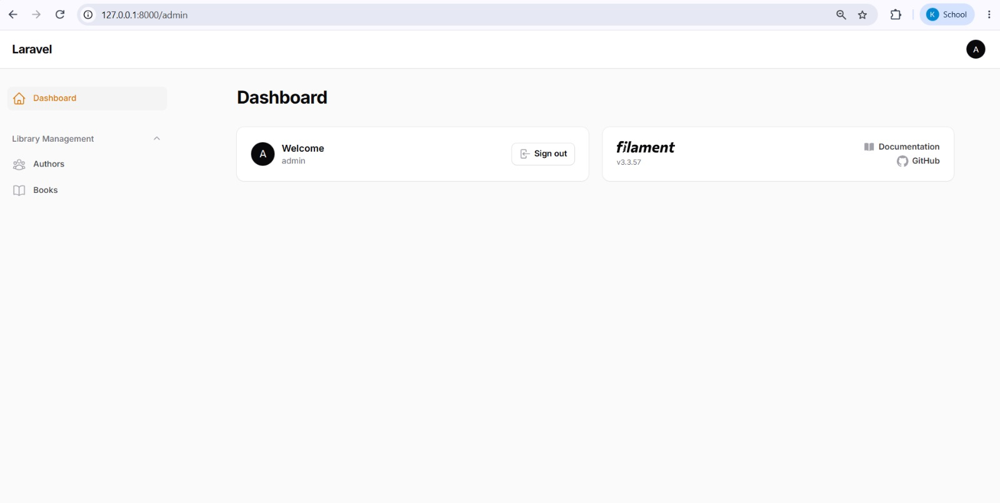
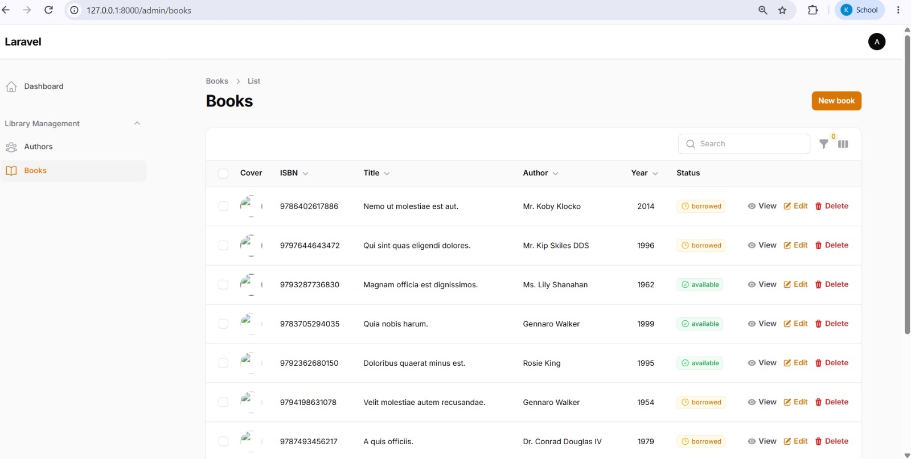
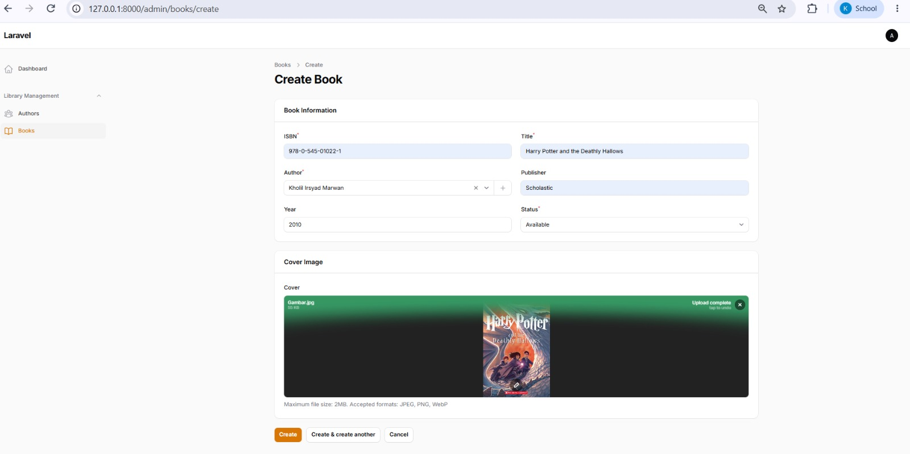
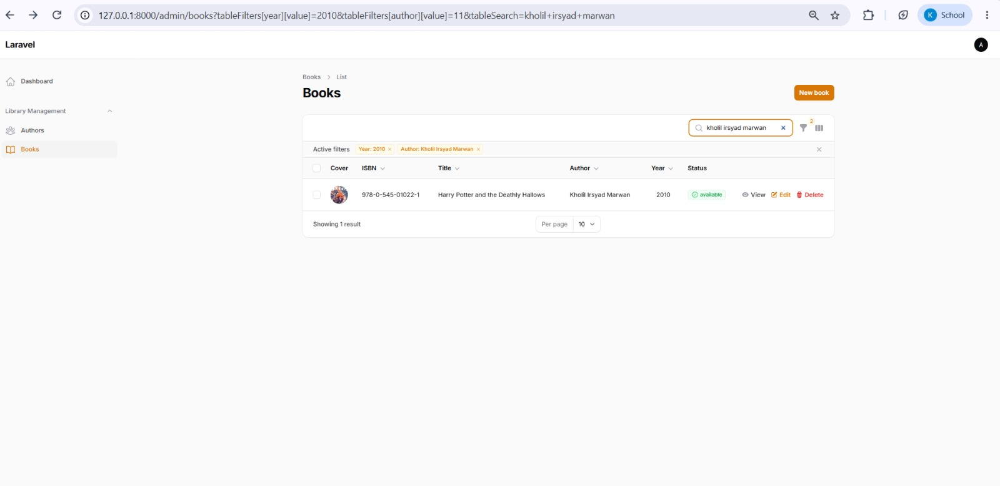
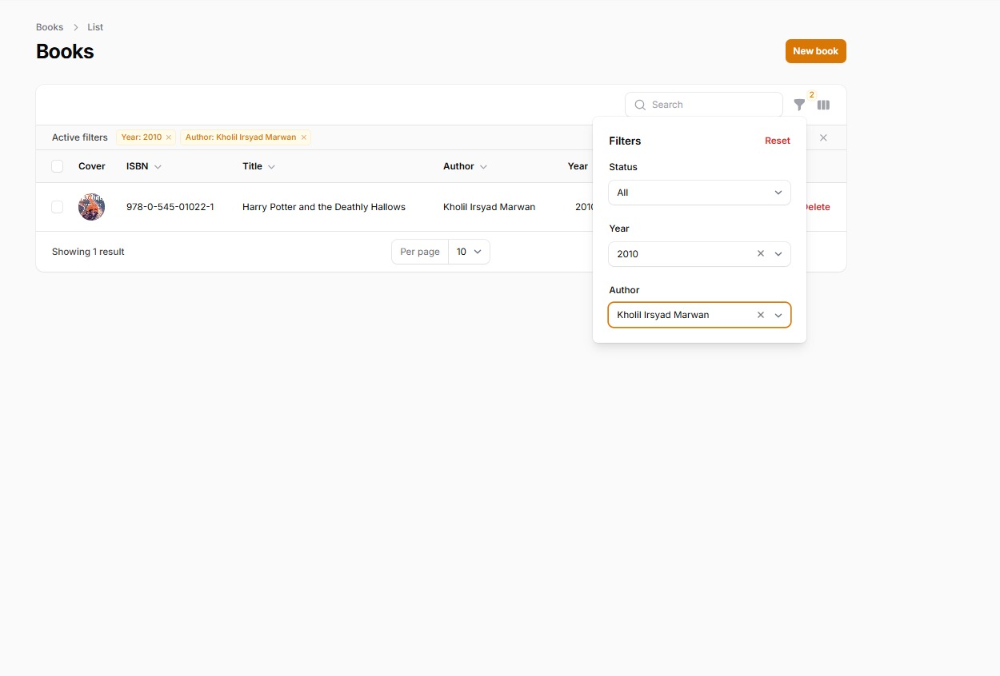

# 📘 Laporan Praktikum Pertemuan Ke - 6

🧑‍🎓 Kholil Irsyad Marwan - 4524210110

# 📚 Book Management System (AuthBook)

Aplikasi manajemen buku dan penulis berbasis web yang dibangun menggunakan Laravel 11 dan Filament v3 Admin Panel untuk Praktikum 6 Pemrograman Berbasis Web.

<p align="center">
  
  
  
  
</p>

📋 Daftar Isi
Instalasi & Penggunaan

Soal & Jawaban Tugas 1

Halaman yang Tersedia

Tentang Aplikasi

Tujuan Praktikum

Fitur Utama

Tech Stack

Struktur Database

📸 Hasil Screenshot Tampilan Aplikasi
---

### 1. Clone Repository

Buka terminal dan jalankan perintah clone untuk mengunduh repositori:

```bash
git clone [https://github.com/KholilIrsyadMarwan/4524210110_KHOLILIRSYADMARWAN_PBW-A-Praktikum6.git](https://github.com/KholilIrsyadMarwan/4524210110_KHOLILIRSYADMARWAN_PBW-A-Praktikum6.git)

cd 4524210110_KHOLILIRSYADMARWAN_PBW-A/authbook

```
### 2. Install PHP Dependencies
Instal seluruh pustaka PHP yang dibutuhkan (termasuk Filament v3): <br>


``` bash
composer install
```

### 3. Setup Environment (.env)

Salin file .env.example menjadi .env lalu generate application key:

``` bash
cp .env.example .env
php artisan key:generate
```
Catatan Konfigurasi Database (SQLite):

Pastikan di dalam file .env variabel database sudah terkonfigurasi ke SQLite:

Ini, TOML 
DB_CONNECTION=sqlite

### 4. Setup Database & Seeding Data Dummy
Jalankan migrasi database untuk membuat tabel authors & books, sekaligus mengisi data dummy (10 Author & 50 Book): <br>

```bash
php artisan migrate:fresh --seed
```

### 5. Membuat Account Admin Filament
Buat akun pengguna agar bisa masuk ke dalam Filament Admin Panel: <br>

```bash
php artisan make:filament-user
```

Input data akun: <br>

Name: Admin<br>

Email address: admin@example.com<br>

Password: password<br>

### 6. Jalankan Local Development Server
Jalankan server bawaan Laravel: <br>

```bash
php artisan serve
```
 ### 📋 Daftar Isi
Instalasi & Penggunaan

Soal & Jawaban Tugas 1

Halaman yang Tersedia

Tentang Aplikasi

Tujuan Praktikum

Fitur Utama

Tech Stack

Struktur Database

📸 Hasil Screenshot Tampilan Aplikasi

 ### 📌 Soal & Jawaban Tugas 1
Tugas 1: Implementasi Dasar (Nilai: 40)

Implementasikan semua langkah di atas dan buktikan dengan:

### 1. Screenshot admin panel yang berhasil login


### 2. Screenshot list books dengan data yang terseed

### 3. Screenshot form create book

### 4. Screenshot hasil pencarian

### 5. Screenshot filter aktif
### 💡 Jawaban Bukti Implementasi (Screenshot):
###  1. Screenshot Admin Panel yang Berhasil Login

###  2. Screenshot List Books dengan Data yang Terseed (50 Books)
   
###  3. Screenshot Form Create Book
   
###  4. Screenshot Hasil Pencarian
   
###  5. Screenshot Filter Aktif
   
